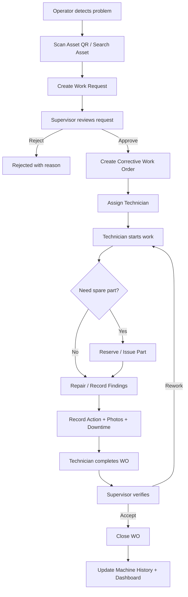
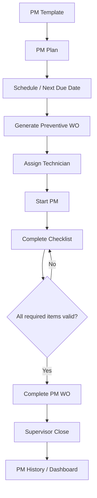
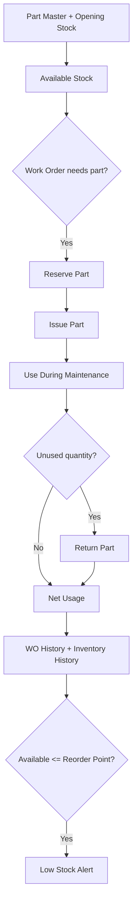
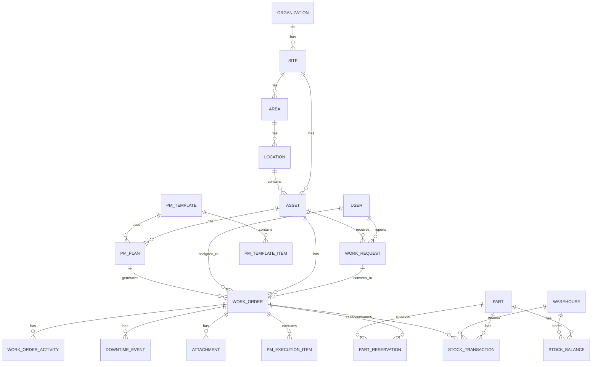

# CMMS Maintenance Management System
## Phase 1–3 Implementation Specification

**Document Type:** Product Requirement + Software Requirement + System Design + Codex Implementation Specification  
**Version:** 1.0  
**Scope:** Phase 1, Phase 2, Phase 3 only  
**Primary Goal:** Build a stable, usable CMMS for pilot and real operational use before expanding to advanced analytics, purchasing, IoT, predictive maintenance, AI, or enterprise SaaS features.  
**Implementation Strategy:** MVP-first, responsive Web App/PWA, single codebase, PostgreSQL, no Docker required.  
**Primary Language:** Thai UI first; code, database identifiers, API names, and technical documentation in English.  
**Default Timezone:** Asia/Bangkok  
**Status:** Build specification for Codex / engineering implementation.

---

# 0. How to Use This Document

This document is the **Source of Truth** for the current implementation.

Codex and developers must implement **only the scope in Phase 1, Phase 2, and Phase 3** unless a change is explicitly approved.

The supplied `PM.txt` and UI reference images are supporting references for product intent, workflows, layout, and visual direction. If those references conflict with this document, **this document wins**.

Do not implement later-phase features simply because they appear in the reference materials.

## Current Release Scope

```text
Phase 1
Asset + QR + Work Request + Work Order + Downtime + Machine History + Basic Dashboard

Phase 2
Preventive Maintenance + PM Plan + PM Schedule + PM Checklist + PM Work Order

Phase 3
Spare Parts + Stock + Reservation + Issue + Return + Adjustment + Low Stock
```

## Explicitly Out of Scope

The following are **not part of this release**:

- Predictive Maintenance
- AI / Machine Learning
- IoT / MQTT / sensor ingestion
- Root Cause Analysis module
- CAPA
- Purchase Request / Purchase Order
- Supplier management
- Maintenance budget
- Full maintenance-cost accounting
- Labor payroll integration
- ERP integration
- SCADA / PLC integration
- Advanced MTBF / MTTR / OEE analytics
- Native iOS / Android application
- Offline-first synchronization
- Multi-tenant SaaS billing
- Subscription management
- Complex multi-company architecture
- Advanced approval workflow engine
- Dynamic workflow builder
- Advanced notification channels such as LINE, Slack, Teams
- Predictive spare-part forecasting
- Automated inventory purchasing

These may be added in later releases without redesigning the core domain.

---

# 1. Product Vision

Build a practical maintenance management system that helps the engineering and maintenance team move from fragmented records, paper, chat messages, and spreadsheets into one operational system.

The current product must support the complete day-to-day maintenance loop:

```text
Register Asset
      ↓
Generate / Scan QR
      ↓
Report Problem
      ↓
Create Work Request
      ↓
Review / Convert to Work Order
      ↓
Assign Technician
      ↓
Perform Repair
      ↓
Record Downtime + Findings + Action
      ↓
Complete / Close
      ↓
Machine History
      ↓
Dashboard
```

Then extend the same foundation with:

```text
Preventive Maintenance
      ↓
Scheduled PM
      ↓
PM Work Order
      ↓
Checklist
      ↓
Completion History
```

and:

```text
Spare Parts
      ↓
Stock Balance
      ↓
Reserve / Issue / Return
      ↓
Link Parts to Work Order
      ↓
Low Stock Visibility
```

The product should first prove that it is reliable and useful in real daily maintenance work before adding advanced modules.

---

# 2. Business Objectives

The system must help the maintenance department achieve the following:

1. Keep one authoritative asset register.
2. Reduce the time required to report machine problems.
3. Provide traceability from request to completed repair.
4. Make technician assignment and work status visible.
5. Capture machine downtime in a consistent format.
6. Preserve repair history by asset.
7. Reduce dependence on personal memory and chat messages.
8. Plan recurring PM work.
9. Ensure PM tasks are completed with a checklist.
10. Track spare-part availability and usage.
11. Know which parts were used on which machine and work order.
12. Show a simple management dashboard using operational data.
13. Provide a responsive interface that works on desktop and mobile browsers.
14. Produce an architecture that can later support analytics, cost, purchasing, IoT, and AI without major rework.

---

# 3. Design Principles

## 3.1 Build Small, Design for Growth

Do not build the full future CMMS now. Keep the current implementation intentionally small.

However:

- use stable entity IDs,
- maintain clean domain boundaries,
- preserve audit fields,
- keep work history immutable where appropriate,
- avoid hard-coded plant names,
- keep master data configurable,
- separate presentation from business rules,
- and use database constraints for important invariants.

## 3.2 Operational Simplicity

The main workflow must be usable by technicians and operators with minimal training.

A normal breakdown should require as few steps as possible.

## 3.3 Mobile First for Shop-Floor Tasks

Technicians and operators are expected to use phones frequently.

Primary mobile workflows:

- scan QR,
- view asset,
- create request,
- view assigned work,
- start work,
- record repair,
- complete checklist,
- issue/return parts,
- upload photos.

## 3.4 Desktop First for Planning and Administration

Supervisors and administrators need dense screens for:

- asset management,
- work planning,
- PM planning,
- inventory,
- dashboard,
- master data,
- user management.

## 3.5 Traceability

Important operational changes must identify:

- who performed the action,
- when it occurred,
- previous state if applicable,
- resulting state,
- related asset/work order.

## 3.6 No Docker Requirement

Docker is **not required** for this release.

The application must be able to run with:

```bash
npm install
npm run dev
```

plus access to a PostgreSQL database.

Docker support may be added later, but Codex must not make Docker a prerequisite for development or deployment.

---

# 4. Recommended Technology Stack

## 4.1 Application Architecture

Use a **Next.js full-stack modular monolith**.

```text
Desktop Browser / Mobile Browser
              │
              ▼
┌───────────────────────────────────┐
│              Next.js              │
│                                   │
│  UI / Pages / Components          │
│  Server Actions / Route Handlers  │
│  Domain Services                  │
│  Authentication / Authorization   │
│  Validation                       │
│  Reporting Queries                │
└──────────────────┬────────────────┘
                   │
                   ▼
            ┌──────────────┐
            │ PostgreSQL   │
            └──────────────┘
                   │
                   ▼
            File Storage Adapter
           Local Dev / S3 Later
```

## 4.2 Stack

### Core

- Next.js 16+
- React 19+
- TypeScript
- Node.js current LTS
- PostgreSQL
- Prisma ORM

### UI

- Tailwind CSS
- shadcn/ui
- Lucide icons
- Recharts
- responsive layouts

### Forms and Validation

- React Hook Form
- Zod
- Server-side validation is mandatory.

### Authentication

Preferred:

- Auth.js / NextAuth compatible architecture
- credentials-based login for initial pilot
- hashed passwords using a secure password hashing library

Do not store plain-text passwords.

### File Upload

Implement a storage abstraction:

```ts
StorageProvider {
  upload(...)
  delete(...)
  getUrl(...)
}
```

Initial development provider:

- local file storage

Production-ready adapter can later use:

- S3-compatible object storage

### QR

- Generate a QR for each asset.
- QR payload should use an application URL or stable asset token.
- Do not encode sensitive asset data directly in QR.

### Testing

- Vitest or Jest for unit tests
- React Testing Library where useful
- Playwright for critical end-to-end flows

### Code Quality

- ESLint
- Prettier
- TypeScript strict mode

---

# 5. Repository Structure

Recommended structure:

```text
/
├── app/
│   ├── (auth)/
│   ├── (dashboard)/
│   ├── api/
│   └── qr/
├── components/
│   ├── ui/
│   ├── layout/
│   ├── forms/
│   ├── tables/
│   ├── charts/
│   └── maintenance/
├── modules/
│   ├── auth/
│   ├── users/
│   ├── locations/
│   ├── assets/
│   ├── work-requests/
│   ├── work-orders/
│   ├── downtime/
│   ├── pm/
│   ├── inventory/
│   ├── dashboard/
│   ├── audit/
│   └── files/
├── lib/
│   ├── db/
│   ├── auth/
│   ├── permissions/
│   ├── validation/
│   ├── storage/
│   ├── qr/
│   ├── dates/
│   └── utils/
├── prisma/
│   ├── schema.prisma
│   ├── migrations/
│   └── seed.ts
├── public/
├── tests/
│   ├── unit/
│   ├── integration/
│   └── e2e/
├── docs/
│   ├── ASSUMPTIONS.md
│   ├── DECISIONS.md
│   ├── DATA_MODEL.md
│   ├── API.md
│   └── TEST_PLAN.md
├── .env.example
├── README.md
└── package.json
```

Rules:

- Do not place all business logic in page components.
- Keep business rules in module services.
- Keep database queries in repositories/services or clearly separated server-side modules.
- Shared UI components must not contain domain-specific database logic.

---

# 6. Core Domain Hierarchy

For the current release:

```text
Organization
└── Site
    └── Area
        └── Location / Production Line
            └── Asset
```

Although the pilot may use only one organization and one site, do not hard-code this assumption into the data model.

Use a simple hierarchy now so that a future second site can be added without migration of all operational data.

---

# 7. User Roles

Current release roles:

1. **ADMIN**
2. **MAINTENANCE_SUPERVISOR**
3. **TECHNICIAN**
4. **REQUESTER**
5. **STOREKEEPER**
6. **MANAGER_VIEWER**

## 7.1 ADMIN

Can:

- manage users,
- manage roles assigned to users,
- manage locations,
- manage asset masters,
- manage PM master,
- manage parts master,
- view all operational records,
- perform configuration.

## 7.2 MAINTENANCE_SUPERVISOR

Can:

- view and triage work requests,
- reject/accept requests,
- create work orders,
- assign technicians,
- change priority,
- monitor progress,
- verify/close work orders,
- create/edit PM plans,
- view stock,
- view dashboards.

## 7.3 TECHNICIAN

Can:

- view own assigned work orders,
- view asset information/history,
- start work,
- pause work,
- add findings/actions/comments,
- upload photos,
- execute PM checklist,
- request or record part usage according to permissions,
- complete work.

Cannot:

- delete assets,
- edit system configuration,
- close verified jobs unless allowed by policy,
- make inventory adjustments unless also a storekeeper.

## 7.4 REQUESTER

Can:

- scan QR,
- view basic asset identity/status,
- create work request,
- upload issue photos,
- view status of own requests.

## 7.5 STOREKEEPER

Can:

- manage part master,
- receive initial/manual stock,
- reserve parts,
- issue parts,
- process part returns,
- adjust stock with reason,
- view low-stock list,
- view usage history.

## 7.6 MANAGER_VIEWER

Read-only access to:

- dashboard,
- asset history,
- work orders,
- PM status,
- inventory summary.

---

# 8. Permission Matrix

Use permission constants internally even if the UI exposes roles.

| Permission | Admin | Supervisor | Technician | Requester | Storekeeper | Manager |
|---|---:|---:|---:|---:|---:|---:|
| user.manage | ✓ |  |  |  |  |  |
| location.manage | ✓ |  |  |  |  |  |
| asset.read | ✓ | ✓ | ✓ | limited | ✓ | ✓ |
| asset.create | ✓ | ✓ |  |  |  |  |
| asset.update | ✓ | ✓ |  |  |  |  |
| work_request.create | ✓ | ✓ | ✓ | ✓ |  |  |
| work_request.read_all | ✓ | ✓ | ✓* |  |  | ✓ |
| work_request.triage | ✓ | ✓ |  |  |  |  |
| work_order.create | ✓ | ✓ |  |  |  |  |
| work_order.assign | ✓ | ✓ |  |  |  |  |
| work_order.start | ✓ | ✓ | ✓ |  |  |  |
| work_order.update_execution | ✓ | ✓ | ✓ |  |  |  |
| work_order.complete | ✓ | ✓ | ✓ |  |  |  |
| work_order.verify_close | ✓ | ✓ |  |  |  |  |
| pm.manage | ✓ | ✓ |  |  |  |  |
| pm.execute | ✓ | ✓ | ✓ |  |  |  |
| inventory.read | ✓ | ✓ | ✓ |  | ✓ | ✓ |
| inventory.manage_master | ✓ |  |  |  | ✓ |  |
| inventory.reserve | ✓ | ✓ |  |  | ✓ |  |
| inventory.issue_return | ✓ |  | limited |  | ✓ |  |
| inventory.adjust | ✓ |  |  |  | ✓ |  |
| dashboard.read | ✓ | ✓ | ✓* |  | ✓* | ✓ |

`*` means restricted view appropriate to the role.

Permission checks must exist server-side; hiding a button is not authorization.

---

# 9. Common Data Standards

## 9.1 IDs

Use UUID/CUID-style stable identifiers.

Do not expose sequential database IDs as the only public identifier.

## 9.2 Human-Readable Codes

Use separate business codes:

```text
Asset:        AST-000001
Work Request: WR-2026-000001
Work Order:   WO-2026-000001
PM Plan:      PM-000001
Part:         PRT-000001
```

Code generation must be centralized and transaction-safe.

## 9.3 Audit Fields

Most master and transactional tables must contain:

```text
id
created_at
created_by
updated_at
updated_by
```

Use soft delete for master records when historical references exist.

Prefer:

```text
is_active
archived_at
```

rather than deleting referenced records.

## 9.4 Time

- Store timestamps in UTC.
- Display in configured local timezone, default Asia/Bangkok.
- Do not store localized formatted strings as timestamps.

## 9.5 Attachments

Allowed initial file types:

- JPG
- JPEG
- PNG
- WEBP
- PDF

Set configurable size limit.

Validate MIME type and file extension server-side.

---

# 10. Master Data

Minimum configurable master data:

- Organization
- Site
- Area
- Location / Production Line
- Asset Category
- Asset Criticality
- Work Priority
- Failure Category
- Work Type
- Part Category
- Unit of Measure
- Users
- Teams

Do not hard-code factory-specific names.

---

# 11. PHASE 1 — Core Maintenance MVP

# 11.1 Objective

Phase 1 must make the system usable for actual corrective maintenance.

A user must be able to identify an asset, report a problem, create/receive a work order, repair the machine, record downtime and repair information, complete the job, and later retrieve the full history.

# 11.2 Phase 1 Modules

1. Authentication
2. Users / Basic roles
3. Site / Area / Location
4. Asset Management
5. QR Code
6. Work Request
7. Corrective Work Order
8. Technician Assignment
9. Downtime
10. Attachments / Photos
11. Comments / Activity Timeline
12. Machine History
13. Basic Dashboard
14. Audit Log

---

# 12. Phase 1 — Authentication

## FR-P1-AUTH-001 Login

Users must log in using:

- username or email,
- password.

## FR-P1-AUTH-002 Session

- authenticated session required for protected pages,
- session expiration configurable,
- unauthorized server actions must fail.

## FR-P1-AUTH-003 Account Status

User status:

```text
ACTIVE
INACTIVE
```

Inactive users cannot log in.

## FR-P1-AUTH-004 Password Security

- hash passwords,
- never log passwords,
- never return password hash to client,
- enforce minimum password policy.

## Acceptance Criteria

- valid user can log in,
- invalid password is rejected,
- inactive user is rejected,
- protected URL redirects to login,
- permission-restricted action returns forbidden.

---

# 13. Phase 1 — Location Structure

Entities:

```text
Organization
Site
Area
Location
```

Example:

```text
ABC Manufacturing
└── Plant 1
    └── Production
        └── Line A
```

Requirements:

- Asset belongs to one Site.
- Asset may belong to one Area.
- Asset may belong to one Location.
- Location hierarchy must be visible in asset detail.
- Inactive locations cannot be assigned to new assets.
- Existing history must remain readable.

---

# 14. Phase 1 — Asset Management

## 14.1 Asset Fields

Required minimum:

| Field | Required | Notes |
|---|---:|---|
| asset_code | Yes | unique business code |
| name | Yes | equipment name |
| asset_category_id | Yes | configurable |
| site_id | Yes | operating site |
| area_id | No | optional |
| location_id | No | line/location |
| criticality | Yes | LOW/MEDIUM/HIGH/CRITICAL |
| status | Yes | ACTIVE/INACTIVE/UNDER_MAINTENANCE/OUT_OF_SERVICE |
| manufacturer | No | text |
| model | No | text |
| serial_number | No | text |
| install_date | No | date |
| description | No | text |
| image | No | primary image |
| qr_token | Yes | stable unique token |
| is_active | Yes | default true |

Optional but recommended:

- commissioning_date
- warranty_expiry_date
- note

## 14.2 Asset List

Must support:

- search by code/name/serial,
- filter by site,
- filter by area/location,
- filter by category,
- filter by status,
- filter by criticality,
- pagination,
- sortable columns.

## 14.3 Asset Detail

Tabs:

```text
Overview
Work History
PM
Parts Usage
Attachments
```

During Phase 1:

- Overview and Work History are fully functional.
- PM tab becomes functional in Phase 2.
- Parts Usage becomes functional in Phase 3.

## 14.4 QR Code

Each asset receives a unique QR code.

QR destination:

```text
/qr/{qr_token}
```

After scan:

- logged-in user goes to asset quick view,
- user with request permission can press `แจ้งซ่อม`,
- invalid or inactive token shows safe error.

QR must not contain confidential information.

## 14.5 Asset History

History includes:

- work requests,
- work orders,
- breakdown dates,
- downtime,
- technician,
- failure category,
- findings,
- corrective action,
- status,
- attachments.

Do not copy history text manually into the asset table. Query relational records.

---

# 15. Phase 1 — Work Request

## 15.1 Purpose

A Work Request is a reported problem that has not yet necessarily become an approved Work Order.

## 15.2 Work Request Fields

| Field | Required |
|---|---:|
| request_code | Yes |
| asset_id | Yes |
| title | Yes |
| problem_description | Yes |
| reported_at | Yes |
| reporter_id | Yes |
| priority_requested | Yes |
| failure_observed_at | No |
| machine_stopped | Yes |
| attachment(s) | No |
| status | Yes |

Priority requested:

```text
LOW
MEDIUM
HIGH
URGENT
```

Status:

```text
OPEN
UNDER_REVIEW
APPROVED
REJECTED
CONVERTED
CANCELLED
```

## 15.3 Create Request

Entry paths:

1. Work Request menu
2. Asset detail
3. QR scan

QR path must preselect the asset.

## 15.4 Triage

Supervisor can:

- review request,
- edit approved priority,
- add internal note,
- approve,
- reject with reason,
- convert to Work Order.

## 15.5 Conversion Rule

One Work Request may create one primary Work Order in the current release.

After conversion:

```text
work_request.status = CONVERTED
work_request.converted_work_order_id = WO
```

Do not allow duplicate conversion.

## Acceptance Criteria

- requester can submit with minimum fields,
- supervisor sees request immediately,
- QR request has correct asset preselected,
- reject requires reason,
- converted request links to WO,
- original request remains immutable enough for audit.

---

# 16. Phase 1 — Work Order

## 16.1 Work Order Types

Current release:

```text
CORRECTIVE
PREVENTIVE
```

Phase 1 uses `CORRECTIVE`.
Phase 2 introduces `PREVENTIVE`.

## 16.2 Work Order Fields

Minimum:

| Field | Required |
|---|---:|
| work_order_code | Yes |
| type | Yes |
| asset_id | Yes |
| source_work_request_id | No |
| title | Yes |
| description | Yes |
| priority | Yes |
| status | Yes |
| assigned_to_user_id | No |
| planned_start_at | No |
| due_at | No |
| actual_start_at | No |
| actual_end_at | No |
| failure_observed_at | No |
| failure_category_id | No |
| findings | No |
| cause_text | No |
| action_taken | No |
| completion_note | No |
| created_by | Yes |

## 16.3 Work Order Status

Use this state machine:

```text
OPEN
  ↓
ASSIGNED
  ↓
IN_PROGRESS
  ├── WAITING_PART
  ├── PAUSED
  ↓
COMPLETED
  ↓
CLOSED
```

Alternative terminal state:

```text
CANCELLED
```

## 16.4 Allowed Transitions

```text
OPEN -> ASSIGNED
OPEN -> CANCELLED

ASSIGNED -> IN_PROGRESS
ASSIGNED -> OPEN
ASSIGNED -> CANCELLED

IN_PROGRESS -> PAUSED
IN_PROGRESS -> WAITING_PART
IN_PROGRESS -> COMPLETED

PAUSED -> IN_PROGRESS
PAUSED -> CANCELLED

WAITING_PART -> IN_PROGRESS
WAITING_PART -> CANCELLED

COMPLETED -> IN_PROGRESS   (Supervisor rework only)
COMPLETED -> CLOSED

CLOSED -> no normal transition
CANCELLED -> no normal transition
```

Transitions must be validated server-side.

## 16.5 Assignment

Supervisor selects:

- technician,
- optional planned start,
- optional due date.

When assigned:

- status becomes ASSIGNED,
- assignment event is recorded,
- technician sees job in My Work.

## 16.6 Start Work

When technician presses Start:

- validate assignment/permission,
- set `actual_start_at` if empty,
- set status `IN_PROGRESS`,
- create activity event.

Do not overwrite original first-start timestamp on resume.

## 16.7 Pause / Waiting Part

Pause requires:

- reason.

Waiting Part may optionally select missing part after Phase 3 is available.

Track status durations in event history if practical.

## 16.8 Complete Work

Technician must enter:

- findings,
- action taken,
- completion note optional,
- failure category if corrective,
- completion photos optional/configurable.

Completion sets:

```text
status = COMPLETED
actual_end_at = current time
```

## 16.9 Close Work

Supervisor reviews completed work.

Supervisor can:

- close,
- return to In Progress with reason.

Closed records are operationally immutable except privileged corrections with audit logging.

---

# 17. Phase 1 — Work Order Activity Timeline

Every Work Order detail page must show timeline events such as:

```text
Created
Assigned to Technician A
Started
Photo added
Comment added
Paused
Resumed
Completed
Returned for rework
Closed
Part issued (Phase 3)
```

Use an event/activity table rather than constructing the timeline only from current record values.

Activity fields:

- event_type
- work_order_id
- actor_user_id
- message
- metadata JSON if needed
- created_at

---

# 18. Phase 1 — Downtime

## 18.1 Purpose

Track time that production equipment is unavailable due to the reported failure.

## 18.2 Downtime Fields

```text
id
asset_id
work_order_id
started_at
ended_at
duration_minutes
reason
created_by
created_at
updated_at
```

## 18.3 Rules

- downtime can be created from a Work Request or Work Order.
- a corrective WO can have zero or one primary downtime event in this release.
- `ended_at` cannot be before `started_at`.
- duration is calculated server-side.
- if still down, `ended_at` is null and dashboard treats it as active downtime.
- closing a WO with active downtime must warn the supervisor.
- if machine never stopped, downtime is not required.

## 18.4 Dashboard Calculation

Total downtime for period:

```text
SUM(duration_minutes)
```

For open downtime:

```text
current_time - started_at
```

display separately as ongoing downtime.

---

# 19. Phase 1 — Comments and Attachments

## Comments

Users with access to WO can add comments.

Comments are append-only in normal operation.

## Attachments

Support:

- request photos,
- work-order before/after photos,
- PDF documents.

Attachment metadata:

```text
id
entity_type
entity_id
file_name
mime_type
file_size
storage_key
uploaded_by
created_at
```

Do not store binary files directly in PostgreSQL.

---

# 20. Phase 1 — Machine History

The Asset History view is a core feature.

It must show chronological records:

- Work Requests
- Corrective Work Orders
- Preventive Work Orders after Phase 2
- Downtime events
- Part usage after Phase 3

Filters:

- date range,
- work type,
- status,
- failure category.

Each history row must link to original record.

---

# 21. Phase 1 — Dashboard

The dashboard must remain intentionally simple.

## KPI Cards

- Total Assets
- Assets Under Maintenance
- Open Work Requests
- Open Work Orders
- In Progress Work Orders
- Completed Work Orders in selected period
- Overdue Work Orders
- Total Downtime in selected period

## Charts

1. Work Orders by Status
2. Corrective Work Orders by Asset
3. Corrective Work Orders by Area/Location
4. Breakdown Trend by Day/Week/Month
5. Downtime by Asset
6. Technician Assigned Workload

## Filters

- date range,
- site,
- area,
- asset category.

Do not implement complex reliability analytics in this phase.

## Definition of Overdue

```text
due_at < current_time
AND status NOT IN (COMPLETED, CLOSED, CANCELLED)
```

---

# 22. Phase 1 — Screens

## Desktop Navigation

```text
Dashboard
Assets
Work Requests
Work Orders
PM              [enabled in Phase 2]
Spare Parts     [enabled in Phase 3]
Users           [admin]
Master Data     [admin]
Settings
```

## Mobile Bottom Navigation

Recommended:

```text
Home
Assets
Work
PM
More
```

After Phase 3, spare parts can appear under More or role-specific navigation.

## Required Screens

### Authentication
- Login

### Dashboard
- Overview dashboard

### Assets
- Asset list
- Asset create/edit
- Asset detail
- QR display/print
- QR scan page

### Work Requests
- Request list
- Create request
- Request detail / triage

### Work Orders
- WO list
- My Work
- WO detail
- WO execution
- Completion form

### Admin
- User list/create/edit
- Site/Area/Location master
- Asset category
- Failure category

---

# 23. Phase 1 — UX Requirements

## Mobile

- large tap targets,
- minimal typing,
- camera/photo friendly,
- status badges,
- visible primary action button,
- avoid wide data tables,
- use cards and accordions.

## Desktop

- searchable tables,
- filters,
- bulk-friendly navigation,
- right-side detail panel optional,
- pagination.

## Status Colors

Use a consistent semantic system but do not rely on color alone.

Example semantics:

- neutral = open
- blue = assigned/in progress
- amber = waiting/pause
- green = completed/closed
- red = urgent/cancelled/error where appropriate

Actual colors should follow the design system.

---

# 24. PHASE 2 — Preventive Maintenance

# 24.1 Objective

Phase 2 adds scheduled maintenance so the organization can move from only reacting to breakdowns toward planned prevention.

# 24.2 Scope

Include:

- PM Template
- PM Plan
- Calendar/interval schedule
- PM Checklist
- PM Work Order generation
- PM Calendar
- Due/Overdue tracking
- PM execution
- PM history
- PM dashboard summary

Do not include:

- predictive scheduling,
- sensor-triggered PM,
- AI recommendations,
- complex meter-based scheduling in the first version.

---

# 25. Phase 2 — PM Template

A PM Template defines reusable work instructions.

Fields:

```text
id
template_code
name
description
asset_category_id optional
estimated_duration_minutes optional
safety_note optional
is_active
created_at
updated_at
```

A template has ordered checklist items.

---

# 26. Phase 2 — PM Checklist Template

Checklist item types:

```text
CHECK
TEXT
NUMBER
PASS_FAIL
```

Fields:

```text
id
pm_template_id
sequence
title
instruction
item_type
required
unit optional
min_value optional
max_value optional
requires_note_on_fail
requires_photo_on_fail
is_active
```

Rules:

- sequence must be deterministic,
- required item must be answered before completion,
- NUMBER may validate min/max,
- FAIL may require note,
- failed item must remain visible in completed history.

---

# 27. Phase 2 — PM Plan

A PM Plan links a schedule to an asset and template.

Fields:

```text
id
pm_plan_code
asset_id
pm_template_id
name
frequency_type
interval_value
start_date
next_due_date
lead_days
assigned_team_id optional
assigned_user_id optional
estimated_duration_minutes optional
is_active
last_generated_at optional
created_by
created_at
updated_at
```

## Frequency Types

Initial release:

```text
DAILY
WEEKLY
MONTHLY
QUARTERLY
SEMI_ANNUAL
ANNUAL
CUSTOM_DAYS
```

For `CUSTOM_DAYS`, use `interval_value`.

Examples:

```text
CUSTOM_DAYS + 14 = every 14 days
MONTHLY = every 1 month
QUARTERLY = every 3 months
```

## Scheduling Strategy

Use a fixed planned schedule by default:

```text
next_due_date = previous planned due date + frequency
```

Do not shift the entire future schedule merely because a technician completed one PM late.

---

# 28. Phase 2 — PM Generation

The system must generate a PREVENTIVE Work Order when the PM enters its lead window.

Example:

```text
next_due_date = 2026-11-10
lead_days = 7

Generate from 2026-11-03 onward
```

Generation must be idempotent.

Do not create duplicate PM WO for the same:

```text
pm_plan_id + scheduled_due_date
```

Recommended unique constraint:

```text
UNIQUE(pm_plan_id, scheduled_due_date)
```

## Scheduler

In this release, support a server-side scheduled job or protected manual trigger.

The application should have:

- automatic scheduler when hosting supports it,
- admin/manual `Generate Due PM` action as fallback.

Do not require Redis/BullMQ just for this release.

---

# 29. Phase 2 — Preventive Work Order

Preventive WO reuses the core `work_orders` table with:

```text
type = PREVENTIVE
pm_plan_id
scheduled_due_date
```

When generated:

- copy title/description from PM plan/template,
- copy checklist into execution snapshot,
- assign default technician/team if configured,
- set due date,
- status OPEN or ASSIGNED depending on assignment.

Do not reference checklist template live during execution only. Create execution records so later template edits do not alter historical PM evidence.

---

# 30. Phase 2 — PM Execution

Technician flow:

```text
Open PM Work Order
      ↓
Review asset / instructions
      ↓
Start Work
      ↓
Complete checklist
      ↓
Enter notes/readings
      ↓
Attach photo when required
      ↓
Complete PM
      ↓
Supervisor Close
```

## Completion Rules

A PM cannot be completed if:

- required checklist item is unanswered,
- required fail note is missing,
- required photo is missing,
- work has never been started.

---

# 31. Phase 2 — Checklist Execution Data

Fields:

```text
id
work_order_id
source_template_item_id optional
sequence
title_snapshot
instruction_snapshot
item_type
required
response_boolean optional
response_text optional
response_number optional
pass_fail_result optional
note optional
completed_by optional
completed_at optional
```

Historical checklist wording must remain stable even if the template changes later.

---

# 32. Phase 2 — PM Calendar

Views:

- Month
- List

Statuses:

```text
Upcoming
Due Soon
Due
Overdue
Completed
```

Suggested rules:

```text
Upcoming = before lead window
Due Soon = within lead window, before due date
Due = due date today
Overdue = due date passed and PM WO not completed/closed
Completed = PM WO completed/closed
```

Filters:

- site,
- area,
- asset,
- technician,
- status.

---

# 33. Phase 2 — PM Dashboard Additions

Add:

- PM Due This Week
- PM Overdue
- PM Completed This Month
- PM Completion Rate

PM Completion Rate:

```text
completed PM work orders due in period
---------------------------------------
all PM work orders due in period
```

Clearly define whether cancelled PM is excluded. Default:

- exclude CANCELLED with approved reason from denominator,
- keep an audit trail.

---

# 34. Phase 2 — PM Screens

Required:

- PM Template List
- PM Template Create/Edit
- PM Checklist Builder
- PM Plan List
- PM Plan Create/Edit
- PM Calendar
- PM Work Order Detail
- Mobile PM Checklist
- PM History by Asset

Checklist builder should support:

- add item,
- edit item,
- delete inactive/unreferenced item,
- reorder item,
- mark required,
- configure item type,
- set min/max for number.

---

# 35. PHASE 3 — Spare Parts and Inventory

# 35.1 Objective

Phase 3 links maintenance work to spare-part availability and actual usage.

The system must answer:

- What parts are in stock?
- Where are they stored?
- Which parts are low?
- Which parts were used on a work order?
- Which machine consumed each part?
- What stock movements occurred and who performed them?

# 35.2 Scope

Include:

- Part Master
- Warehouse/Stock Location
- Stock Balance
- Stock Transaction
- Reservation
- Issue to WO
- Return from WO
- Manual Adjustment
- Low Stock
- Part Usage History
- Basic Stock Dashboard

Do not include:

- Purchase Request
- Purchase Order
- Supplier module
- Goods receipt against PO
- Accounts payable
- Advanced costing methods
- Lot/serial tracking unless explicitly added later

---

# 36. Phase 3 — Part Master

Fields:

| Field | Required |
|---|---:|
| part_code | Yes |
| name | Yes |
| category_id | Yes |
| unit_of_measure_id | Yes |
| description | No |
| manufacturer | No |
| manufacturer_part_no | No |
| min_stock | Yes |
| reorder_point | Yes |
| unit_cost_reference | No |
| is_critical | Yes |
| image | No |
| is_active | Yes |

Rules:

- `part_code` unique,
- min/reorder quantities >= 0,
- inactive parts remain visible in history,
- inactive parts cannot be issued to new jobs unless privileged override.

---

# 37. Phase 3 — Warehouse

For current scope:

```text
Warehouse
└── optional Bin/Location text
```

Warehouse fields:

```text
id
code
name
site_id
description
is_active
```

A part may have stock in multiple warehouses.

---

# 38. Phase 3 — Stock Balance

Maintain balance per:

```text
part_id + warehouse_id
```

Fields:

```text
on_hand_qty
reserved_qty
```

Derived:

```text
available_qty = on_hand_qty - reserved_qty
```

Do not manually persist `available_qty` unless there is a strong implementation reason.

Rules:

- no negative `on_hand_qty` by default,
- no reservation larger than available stock,
- quantities must be decimal-safe for UOMs that are not integer-only,
- inventory updates must use database transactions.

---

# 39. Phase 3 — Stock Transactions

Transaction types:

```text
INITIAL
RECEIPT_MANUAL
RESERVE
UNRESERVE
ISSUE
RETURN
ADJUST_IN
ADJUST_OUT
```

`RESERVE` and `UNRESERVE` affect reservation state. They may be represented as reservation records plus an audit transaction depending on implementation.

Stock transaction minimum fields:

```text
id
transaction_code
part_id
warehouse_id
type
quantity
work_order_id optional
reference_text optional
reason optional
performed_by
created_at
```

## Immutable Ledger Rule

Stock transaction rows must not be edited after posting.

Corrections use a reversing or adjustment transaction.

This is critical for auditability.

---

# 40. Phase 3 — Part Reservation

Reservation fields:

```text
id
work_order_id
part_id
warehouse_id
quantity
status
created_by
created_at
updated_at
```

Status:

```text
ACTIVE
PARTIALLY_ISSUED
FULFILLED
CANCELLED
```

Rules:

- active reservation reduces available stock,
- issuing against reservation reduces `on_hand` and `reserved`,
- cancelling reservation releases reserved quantity,
- closed/cancelled WO must not leave active reservation; system warns or auto-releases according to explicit service logic.

---

# 41. Phase 3 — Issue Part to Work Order

Storekeeper or authorized user selects:

- Work Order
- Part
- Warehouse
- Quantity

System must:

1. validate WO is operationally eligible,
2. validate sufficient stock,
3. post ISSUE transaction,
4. decrease on-hand,
5. consume reservation if applicable,
6. create Work Order Part Usage,
7. add WO activity event.

Eligible WO statuses by default:

```text
ASSIGNED
IN_PROGRESS
PAUSED
WAITING_PART
```

Supervisor/admin override may be allowed with audit.

---

# 42. Phase 3 — Return Part

A previously issued unused part may be returned.

Rules:

- return must reference a WO,
- return quantity cannot exceed outstanding issued-minus-returned quantity for that part/WO unless privileged adjustment is used,
- create RETURN transaction,
- increase on-hand,
- update net usage.

---

# 43. Phase 3 — Work Order Part Usage

Fields:

```text
id
work_order_id
part_id
warehouse_id
issued_qty
returned_qty
net_used_qty
unit_cost_snapshot optional
created_at
updated_at
```

Derived:

```text
net_used_qty = issued_qty - returned_qty
```

This record may be a summary derived from ledger or maintained transactionally.

Ledger remains authoritative.

---

# 44. Phase 3 — Manual Stock Adjustment

Allowed only for:

- Admin
- Storekeeper

Required:

- part,
- warehouse,
- quantity,
- direction,
- reason.

Examples:

- physical count correction,
- damaged stock,
- opening balance correction.

Every adjustment must create a stock transaction.

Never directly edit balance without a transaction.

---

# 45. Phase 3 — Low Stock

Default low-stock condition:

```text
available_qty <= reorder_point
```

Show:

- part code,
- name,
- warehouse,
- on hand,
- reserved,
- available,
- reorder point,
- critical indicator.

No automatic purchase request in this release.

---

# 46. Phase 3 — Inventory Screens

Required:

- Part List
- Part Create/Edit
- Part Detail
- Warehouse List
- Stock by Warehouse
- Low Stock
- Stock Transactions
- Reservation List
- Issue Part
- Return Part
- Adjustment
- Work Order Parts tab

Part detail tabs:

```text
Overview
Stock
Transactions
Usage History
```

---

# 47. Phase 3 — Dashboard Additions

Add:

- Total Active Parts
- Low Stock Parts
- Critical Parts Low Stock
- Inventory Quantity Summary
- Top Parts Used in Selected Period
- Parts Usage by Asset
- Parts Usage by Work Order

If `unit_cost_reference` is available, optional:

- estimated stock value

Label as estimated/reference value, not accounting valuation.

---

# 48. Cross-Phase Integrated Workflows

# 48.1 Breakdown Workflow



Phase 1 works even before Phase 3 by skipping the parts branch.

---

# 48.2 Preventive Maintenance Workflow



---

# 48.3 Spare Part Workflow



---

# 49. End-to-End Example

Example scenario:

```text
Asset:
MP-003 Cooling Tower

1. Operator notices abnormal sound and lower water flow.
2. Operator scans MP-003 QR.
3. System opens MP-003 quick view.
4. Operator creates WR-2026-000123.
5. Priority requested = MEDIUM.
6. Machine stopped = NO.
7. Supervisor reviews and converts to WO-2026-000456.
8. Supervisor assigns technician Somchai.
9. Technician starts work.
10. Technician finds worn bearing.
11. System shows bearing BRG-6205 in stock.
12. Storekeeper reserves 1 pc and issues it to WO.
13. Technician replaces bearing.
14. Technician records:
    - finding,
    - cause,
    - action,
    - photo.
15. Technician completes WO.
16. Supervisor verifies and closes.
17. MP-003 history now shows:
    - request,
    - repair,
    - technician,
    - part used,
    - dates,
    - duration.
18. Inventory now shows BRG-6205 stock reduced.
19. Dashboard reflects completed WO and part usage.
```

---

# 50. Data Model Overview

Core relationships:



---

# 51. Database Tables

This section defines the minimum expected schema. Codex may normalize or add technical fields, but must preserve the business meaning.

## 51.1 organizations

```text
id
code unique
name
is_active
created_at
updated_at
```

## 51.2 sites

```text
id
organization_id FK
code
name
timezone
is_active
created_at
updated_at
UNIQUE(organization_id, code)
```

## 51.3 areas

```text
id
site_id FK
code
name
is_active
created_at
updated_at
UNIQUE(site_id, code)
```

## 51.4 locations

```text
id
site_id FK
area_id FK nullable
code
name
description nullable
is_active
created_at
updated_at
UNIQUE(site_id, code)
```

## 51.5 users

```text
id
employee_code nullable unique
name
email unique
username unique
password_hash
role enum
site_id nullable
is_active
last_login_at nullable
created_at
updated_at
```

## 51.6 asset_categories

```text
id
code unique
name
description nullable
is_active
created_at
updated_at
```

## 51.7 failure_categories

```text
id
code unique
name
description nullable
is_active
created_at
updated_at
```

## 51.8 assets

```text
id
asset_code unique
name
asset_category_id FK
site_id FK
area_id FK nullable
location_id FK nullable
criticality enum
status enum
manufacturer nullable
model nullable
serial_number nullable
install_date nullable
description nullable
primary_image_attachment_id nullable
qr_token unique
is_active
created_by FK
updated_by FK
created_at
updated_at
archived_at nullable
```

Recommended indexes:

```text
(asset_code)
(name)
(site_id, status)
(location_id)
(asset_category_id)
(qr_token)
```

## 51.9 work_requests

```text
id
request_code unique
asset_id FK
title
problem_description
priority_requested enum
reported_at
failure_observed_at nullable
machine_stopped boolean
status enum
reporter_id FK
reviewed_by nullable FK
reviewed_at nullable
rejection_reason nullable
converted_work_order_id nullable
created_at
updated_at
```

Indexes:

```text
(asset_id, reported_at)
(status, reported_at)
(reporter_id, reported_at)
```

## 51.10 work_orders

```text
id
work_order_code unique
type enum CORRECTIVE/PREVENTIVE
asset_id FK
source_work_request_id nullable FK
pm_plan_id nullable FK
scheduled_due_date nullable
title
description
priority enum
status enum
assigned_to_user_id nullable FK
planned_start_at nullable
due_at nullable
actual_start_at nullable
actual_end_at nullable
failure_observed_at nullable
failure_category_id nullable FK
findings nullable
cause_text nullable
action_taken nullable
completion_note nullable
created_by FK
closed_by nullable FK
closed_at nullable
created_at
updated_at
```

Constraints:

- CORRECTIVE from request may have source request.
- PREVENTIVE may have pm_plan_id.
- unique `(pm_plan_id, scheduled_due_date)` when applicable.

Indexes:

```text
(asset_id, created_at)
(status, due_at)
(assigned_to_user_id, status)
(type, created_at)
(pm_plan_id, scheduled_due_date)
```

## 51.11 work_order_activities

```text
id
work_order_id FK
event_type
actor_user_id FK nullable
message
metadata_json nullable
created_at
```

## 51.12 downtime_events

```text
id
asset_id FK
work_order_id FK
started_at
ended_at nullable
duration_minutes nullable
reason nullable
created_by FK
created_at
updated_at
```

## 51.13 comments

```text
id
entity_type
entity_id
author_user_id FK
body
created_at
```

Prefer a strict typed relation if practical; generic polymorphic relation is acceptable for comments if well tested.

## 51.14 attachments

```text
id
entity_type
entity_id
file_name
mime_type
file_size
storage_key
uploaded_by FK
created_at
```

## 51.15 pm_templates

```text
id
template_code unique
name
description nullable
asset_category_id nullable FK
estimated_duration_minutes nullable
safety_note nullable
is_active
created_by FK
created_at
updated_at
```

## 51.16 pm_template_items

```text
id
pm_template_id FK
sequence
title
instruction nullable
item_type enum
required
unit nullable
min_value nullable
max_value nullable
requires_note_on_fail
requires_photo_on_fail
is_active
created_at
updated_at
UNIQUE(pm_template_id, sequence)
```

## 51.17 pm_plans

```text
id
pm_plan_code unique
asset_id FK
pm_template_id FK
name
frequency_type enum
interval_value nullable
start_date
next_due_date
lead_days default 0
assigned_user_id nullable FK
estimated_duration_minutes nullable
is_active
last_generated_at nullable
created_by FK
created_at
updated_at
```

## 51.18 pm_execution_items

```text
id
work_order_id FK
source_template_item_id nullable FK
sequence
title_snapshot
instruction_snapshot nullable
item_type
required
response_boolean nullable
response_text nullable
response_number nullable
pass_fail_result nullable
note nullable
completed_by nullable FK
completed_at nullable
created_at
updated_at
```

## 51.19 part_categories

```text
id
code unique
name
is_active
created_at
updated_at
```

## 51.20 units_of_measure

```text
id
code unique
name
allows_decimal boolean
is_active
created_at
updated_at
```

## 51.21 parts

```text
id
part_code unique
name
part_category_id FK
unit_of_measure_id FK
description nullable
manufacturer nullable
manufacturer_part_no nullable
min_stock decimal
reorder_point decimal
unit_cost_reference decimal nullable
is_critical boolean
is_active
created_at
updated_at
```

## 51.22 warehouses

```text
id
site_id FK
code
name
description nullable
is_active
created_at
updated_at
UNIQUE(site_id, code)
```

## 51.23 stock_balances

```text
id
part_id FK
warehouse_id FK
on_hand_qty decimal
reserved_qty decimal
updated_at
UNIQUE(part_id, warehouse_id)
```

Constraints:

```text
on_hand_qty >= 0
reserved_qty >= 0
reserved_qty <= on_hand_qty
```

## 51.24 stock_transactions

```text
id
transaction_code unique
part_id FK
warehouse_id FK
type enum
quantity decimal > 0
work_order_id nullable FK
reference_text nullable
reason nullable
performed_by FK
created_at
```

No update/delete through normal application workflow.

## 51.25 part_reservations

```text
id
work_order_id FK
part_id FK
warehouse_id FK
quantity decimal
issued_quantity decimal default 0
status enum
created_by FK
created_at
updated_at
```

## 51.26 audit_logs

```text
id
actor_user_id nullable FK
action
entity_type
entity_id
before_json nullable
after_json nullable
ip_address nullable
created_at
```

Use selectively for critical state and master changes.

---

# 52. Enumerations

## AssetStatus

```text
ACTIVE
INACTIVE
UNDER_MAINTENANCE
OUT_OF_SERVICE
```

## AssetCriticality

```text
LOW
MEDIUM
HIGH
CRITICAL
```

## Priority

```text
LOW
MEDIUM
HIGH
URGENT
```

## WorkRequestStatus

```text
OPEN
UNDER_REVIEW
APPROVED
REJECTED
CONVERTED
CANCELLED
```

## WorkOrderType

```text
CORRECTIVE
PREVENTIVE
```

## WorkOrderStatus

```text
OPEN
ASSIGNED
IN_PROGRESS
PAUSED
WAITING_PART
COMPLETED
CLOSED
CANCELLED
```

## ChecklistItemType

```text
CHECK
TEXT
NUMBER
PASS_FAIL
```

## FrequencyType

```text
DAILY
WEEKLY
MONTHLY
QUARTERLY
SEMI_ANNUAL
ANNUAL
CUSTOM_DAYS
```

## StockTransactionType

```text
INITIAL
RECEIPT_MANUAL
ISSUE
RETURN
ADJUST_IN
ADJUST_OUT
```

## ReservationStatus

```text
ACTIVE
PARTIALLY_ISSUED
FULFILLED
CANCELLED
```

---

# 53. Business Services

Implement explicit services for core business operations.

Examples:

```text
AssetService
WorkRequestService
WorkOrderService
DowntimeService
PmTemplateService
PmPlanService
PmGenerationService
PmExecutionService
InventoryService
ReservationService
DashboardService
AuditService
StorageService
QrService
```

Do not let UI components perform multi-table transactions directly.

---

# 54. API / Server Action Contract

Implementation can use Route Handlers or typed Server Actions, but domain behavior should match these conceptual endpoints.

## Auth

```text
POST /api/auth/login
POST /api/auth/logout
GET  /api/auth/me
```

## Assets

```text
GET    /api/assets
POST   /api/assets
GET    /api/assets/:id
PATCH  /api/assets/:id
GET    /api/assets/:id/history
GET    /api/assets/:id/qr
GET    /api/qr/:token
```

## Work Requests

```text
GET   /api/work-requests
POST  /api/work-requests
GET   /api/work-requests/:id
POST  /api/work-requests/:id/review
POST  /api/work-requests/:id/reject
POST  /api/work-requests/:id/convert-to-work-order
```

## Work Orders

```text
GET   /api/work-orders
POST  /api/work-orders
GET   /api/work-orders/:id
POST  /api/work-orders/:id/assign
POST  /api/work-orders/:id/start
POST  /api/work-orders/:id/pause
POST  /api/work-orders/:id/waiting-part
POST  /api/work-orders/:id/resume
POST  /api/work-orders/:id/complete
POST  /api/work-orders/:id/reopen
POST  /api/work-orders/:id/close
POST  /api/work-orders/:id/comment
POST  /api/work-orders/:id/attachments
```

## PM

```text
GET    /api/pm/templates
POST   /api/pm/templates
GET    /api/pm/templates/:id
PATCH  /api/pm/templates/:id

GET    /api/pm/plans
POST   /api/pm/plans
GET    /api/pm/plans/:id
PATCH  /api/pm/plans/:id

POST   /api/pm/generate-due
GET    /api/pm/calendar
GET    /api/work-orders/:id/checklist
POST   /api/work-orders/:id/checklist/:itemId/response
```

## Inventory

```text
GET    /api/parts
POST   /api/parts
GET    /api/parts/:id
PATCH  /api/parts/:id

GET    /api/warehouses
POST   /api/warehouses

GET    /api/inventory/stock
GET    /api/inventory/transactions
GET    /api/inventory/low-stock

POST   /api/work-orders/:id/parts/reserve
POST   /api/work-orders/:id/parts/issue
POST   /api/work-orders/:id/parts/return

POST   /api/inventory/adjust
```

## Dashboard

```text
GET /api/dashboard/summary
GET /api/dashboard/work-orders
GET /api/dashboard/downtime
GET /api/dashboard/pm
GET /api/dashboard/inventory
```

---

# 55. Validation Rules

At minimum:

- user input validated with Zod server-side,
- IDs must belong to accessible records,
- asset must be active for new operational records unless override,
- cannot assign inactive user,
- cannot assign technician without permission/role,
- work-order transition must be legal,
- completion requires mandatory fields,
- date ranges must be valid,
- PM interval must be valid,
- stock quantity must be positive,
- stock cannot become negative,
- reserved quantity cannot exceed on-hand,
- return cannot exceed net issued,
- file uploads must pass type/size validation,
- duplicate PM generation must be prevented by DB constraint and service logic.

---

# 56. Transaction Boundaries

The following operations must use database transactions:

1. Convert Work Request to Work Order.
2. Assign or transition WO where multiple records/events are created.
3. Generate PM WO + checklist snapshot.
4. Reserve inventory.
5. Issue inventory.
6. Return inventory.
7. Stock adjustment.
8. Close WO if reservation cleanup is performed.

Example inventory issue transaction:

```text
BEGIN
  lock/read stock balance
  validate available quantity
  create stock transaction
  decrement on_hand
  update reservation if applicable
  create/update WO part usage
  create WO activity
COMMIT
```

If any step fails, rollback all.

---

# 57. Concurrency Requirements

Inventory is the main concurrency-sensitive area.

Use a safe transaction strategy to prevent two users issuing the same last stock simultaneously.

Acceptable:

- database row lock,
- atomic conditional update,
- serializable/retry strategy where appropriate.

Do not:

```text
read stock in client
subtract in browser
send new balance
```

The server/database must control balance updates.

---

# 58. Search and Filtering

Use server-side filtering for large lists.

Common query parameters:

```text
page
pageSize
search
status
siteId
areaId
assetId
assignedTo
dateFrom
dateTo
sort
order
```

Default page size:

```text
20 or 25
```

Max reasonable page size:

```text
100
```

---

# 59. Notifications — Minimal Current Scope

Do not build a complex notification platform.

Implement in-app notification only for:

- new assigned WO,
- WO returned for rework,
- PM due/overdue,
- optional low-stock alert for storekeeper/supervisor.

Notification fields:

```text
id
user_id
type
title
message
link
read_at nullable
created_at
```

Email/LINE/Slack/Teams are later integrations.

---

# 60. Audit Requirements

Audit at least:

- user creation/update/deactivation,
- asset create/update/archive,
- Work Request approval/rejection/conversion,
- WO assignment,
- WO status transitions,
- WO close/reopen,
- PM plan create/update/disable,
- part master update,
- stock adjustment,
- stock issue/return,
- role changes.

Do not record sensitive secrets.

---

# 61. Dashboard Query Rules

Dashboard values must come from transactional records, not manually editable summary fields.

Use clear date-boundary logic.

For selected date range:

- breakdown count uses corrective WO created or failure date according to one documented rule,
- completed WO uses actual completion date,
- downtime uses overlap with selected period if possible,
- PM due uses scheduled due date,
- part usage uses issue/return transaction date.

Document the chosen rule in code comments and `docs/DECISIONS.md`.

---

# 62. UI Design Specification

## 62.1 Visual Direction

Use the supplied UI reference images as inspiration for:

- clean industrial maintenance look,
- white/light background,
- strong blue primary navigation,
- orange accent for primary action/attention,
- rounded cards,
- clear icons,
- readable status chips,
- mobile-friendly cards.

Do not copy branding, logos, or exact proprietary graphics.

Create an original product identity.

## 62.2 Responsive Layout

### Desktop

```text
Left Sidebar
Top Header
Content Area
```

### Mobile

```text
Top App Bar
Scrollable Content
Bottom Navigation
Floating/Sticky Primary Action where useful
```

## 62.3 Table Pattern

Desktop tables should support:

- search,
- filters,
- column sort,
- pagination,
- status chips,
- row click to detail.

Mobile uses cards instead of compressed tables.

## 62.4 Form Pattern

Group fields into logical sections.

Use:

- inline validation,
- required markers,
- clear error text,
- confirmation for destructive operations.

Avoid long single-column forms without sections.

---

# 63. Screen-by-Screen Specification

# 63.1 Login

Components:

- product logo/name,
- username/email,
- password,
- sign-in button,
- error message.

No self-registration in current release.

---

# 63.2 Dashboard

Header:

- date range,
- site filter.

Cards:

- Assets
- Open Requests
- Open WO
- In Progress
- Overdue
- Downtime
- PM Due / Overdue after Phase 2
- Low Stock after Phase 3

Charts below.

Cards link to filtered lists where appropriate.

---

# 63.3 Asset List

Desktop columns:

```text
Asset Code
Name
Category
Location
Criticality
Status
Open WO
Actions
```

Mobile card:

```text
Image
Asset Code
Name
Location
Status
Open WO badge
```

Primary action:

```text
+ Add Asset
```

---

# 63.4 Asset Detail

Header:

- image,
- asset code,
- name,
- status,
- location,
- QR button,
- create request button.

Overview cards:

- manufacturer/model,
- serial,
- install date,
- criticality.

Tabs:

- Overview
- History
- PM
- Parts Usage
- Attachments

---

# 63.5 QR Scan

Use device camera when supported.

States:

```text
Request camera permission
Scanning
Found asset
Invalid QR
Permission denied
```

After success show:

```text
Asset name
Asset code
Location
Status
[View Asset]
[Report Problem]
```

---

# 63.6 Work Request Create

Fields:

- asset preselected/search,
- title,
- problem description,
- requested priority,
- failure observed time optional,
- machine stopped toggle,
- photos.

Primary button:

```text
Submit Request
```

---

# 63.7 Work Request Detail

Show:

- request code/status,
- asset,
- reporter,
- time,
- priority,
- description,
- photos.

Supervisor action panel:

- set priority,
- internal note,
- approve/convert,
- reject.

---

# 63.8 Work Order List

Tabs/filters:

- All
- Open
- Assigned
- In Progress
- Waiting
- Completed
- Closed

Filters:

- type,
- site,
- technician,
- asset,
- priority,
- overdue,
- date.

---

# 63.9 My Work — Technician

Mobile-focused.

Sections:

```text
Urgent
Today
In Progress
Waiting
Upcoming PM
```

Each card shows:

- WO code,
- asset,
- title,
- priority,
- status,
- due time/date.

---

# 63.10 Work Order Detail

Header:

- WO code,
- type,
- status,
- priority,
- asset.

Sections:

1. Problem / task description
2. Assignment
3. Timing
4. Downtime
5. Findings
6. Cause
7. Action Taken
8. Checklist if PM
9. Parts if Phase 3
10. Photos
11. Comments
12. Activity timeline

Context-sensitive primary action:

```text
Assign
Start
Pause
Resume
Complete
Close
```

Never show an action the current state/permission does not allow.

---

# 63.11 PM Plan List

Columns:

```text
PM Code
Asset
Plan
Frequency
Next Due
Assigned To
Status
```

Filters:

- due,
- overdue,
- site,
- asset,
- technician.

---

# 63.12 PM Calendar

Monthly calendar plus list toggle.

Each event shows:

- asset code,
- PM name,
- due date,
- status.

Click opens PM/WO detail.

---

# 63.13 PM Checklist Mobile

Top:

- asset,
- WO,
- progress count.

Checklist cards with:

- item title,
- instruction,
- input control,
- pass/fail,
- note,
- photo action where required.

Sticky button:

```text
Save / Complete PM
```

---

# 63.14 Spare Part List

Columns/cards:

- part image,
- part code,
- name,
- available qty,
- UOM,
- low-stock status,
- critical status.

---

# 63.15 Part Detail

Tabs:

- Overview
- Stock
- Transactions
- Usage History

Stock table:

```text
Warehouse
On Hand
Reserved
Available
Reorder Point
```

---

# 63.16 Issue Part

Fields:

- WO
- part
- warehouse
- available quantity
- reserved quantity
- issue quantity

Show validation before confirm.

---

# 64. Error Handling

User-facing errors must be actionable.

Examples:

Bad:

```text
Something went wrong
```

Better:

```text
ไม่สามารถเบิกอะไหล่ได้ เนื่องจากคงเหลือ 1 ชิ้น แต่ต้องการเบิก 2 ชิ้น
```

Log technical details server-side.

Do not expose stack traces in production.

---

# 65. Empty States

Every primary list needs an empty state.

Examples:

```text
ยังไม่มี Work Order
[สร้าง Work Order]

ยังไม่มีแผน PM
[สร้างแผน PM]

ไม่พบอะไหล่ที่ Stock ต่ำ
```

Empty screens should explain the next action.

---

# 66. Accessibility

Minimum:

- keyboard navigation for desktop forms,
- form labels,
- sufficient contrast,
- focus states,
- aria labels for icon-only buttons,
- do not communicate status using color only.

---

# 67. Security Requirements

Mandatory:

- password hashing,
- protected sessions,
- CSRF-safe framework patterns,
- server-side authorization,
- input validation,
- output escaping,
- secure file validation,
- no secret in client bundle,
- `.env` secrets excluded from git,
- rate limit login if practical,
- audit critical changes,
- production HTTPS.

Use OWASP secure coding principles.

---

# 68. Data Integrity Rules

1. Asset referenced by history cannot be hard-deleted.
2. Closed WO cannot be silently modified.
3. Work Request cannot convert twice.
4. PM job generation cannot duplicate scheduled occurrence.
5. Stock transaction is immutable.
6. Stock cannot go negative by normal operation.
7. Required checklist must be completed.
8. Disabled/inactive master data cannot be selected for new records.
9. Server controls all timestamps that affect KPIs where practical.
10. Business state changes go through service methods.

---

# 69. Seed Data

Provide seed data so the application is demonstrable immediately.

Minimum:

## Organization

```text
Demo Manufacturing Co., Ltd.
```

## Site

```text
Plant 1
```

## Areas

```text
Production
Utility
Facility
```

## Locations

```text
Line A
Line B
Utility Area
```

## Users

Create development-only seeded users:

- Admin
- Supervisor
- Technician 1
- Technician 2
- Requester
- Storekeeper
- Manager

Passwords must be obvious development-only values and documented in README, never used in production.

## Assets

At least:

```text
MP-001 Hydraulic Press
MP-002 Air Compressor
MP-003 Cooling Tower
MP-004 Generator
MP-005 Conveyor Line
```

## Parts

At least:

```text
BRG-001 Bearing 6205
FLT-002 Air Filter
BLT-003 V-Belt A52
OIL-004 Hydraulic Oil ISO 68
SLC-005 Seal Kit
```

## PM

Create:

- one monthly PM,
- one quarterly PM,
- one weekly inspection.

## Work Orders

Seed several statuses for dashboard testing.

---

# 70. Non-Functional Requirements

## Performance

For pilot scale:

- common list page response should normally be < 2 seconds under normal load,
- detail pages should feel responsive,
- dashboard queries should be optimized and indexed.

## Scalability Target

Design should comfortably support at least:

```text
10,000 assets
100,000+ work orders
10,000 parts
multiple years of history
```

without schema redesign.

No need to optimize prematurely for millions of real-time sensor events.

## Reliability

- database migrations versioned,
- errors logged,
- transaction boundaries respected,
- no silent stock corruption.

## Browser Support

Current versions of:

- Chrome
- Edge
- Safari mobile

---

# 71. Logging and Observability

For current release:

- structured server logs,
- log request failures,
- log scheduled PM generation results,
- log inventory posting failures,
- no sensitive passwords/tokens.

Later observability platforms can be added.

---

# 72. Backup and Recovery

Production deployment must define:

- PostgreSQL backup,
- attachment backup if stored externally,
- retention policy,
- restore procedure.

At minimum document the process in README/deployment docs.

---

# 73. Environment Configuration

Provide `.env.example` such as:

```env
DATABASE_URL=
AUTH_SECRET=
APP_URL=http://localhost:3000
APP_TIMEZONE=Asia/Bangkok
STORAGE_DRIVER=local
LOCAL_STORAGE_PATH=./storage
MAX_UPLOAD_MB=10
```

Do not commit actual secrets.

---

# 74. No-Docker Development Setup

README must provide instructions similar to:

```bash
git clone <repo>
cd <repo>
npm install

cp .env.example .env

npx prisma migrate dev
npm run db:seed
npm run dev
```

Prerequisites:

- Node.js
- PostgreSQL

Docker instructions may be added as optional documentation later, but must not be required.

---

# 75. Testing Strategy

# 75.1 Unit Tests

Must cover business rules:

- WO status transition
- downtime duration
- PM next due calculation
- PM generation idempotency
- checklist validation
- stock available calculation
- issue stock validation
- return quantity validation
- low-stock determination

# 75.2 Integration Tests

Must cover:

- Work Request -> WO conversion
- WO assignment/start/complete/close
- PM generation + checklist snapshot
- reserve -> issue -> return flow
- stock adjustment
- permission checks

# 75.3 E2E Tests

Critical workflows:

### E2E-001 Corrective Maintenance

```text
Login Requester
Create Work Request
Login Supervisor
Convert to WO
Assign Technician
Login Technician
Start
Complete
Login Supervisor
Close
Verify Asset History
```

### E2E-002 PM

```text
Create PM Template
Create PM Plan
Generate PM WO
Technician executes checklist
Complete
Close
Verify PM history
```

### E2E-003 Inventory

```text
Create Part
Set Initial Stock
Reserve to WO
Issue
Return partial quantity
Verify balance
Verify ledger
```

### E2E-004 QR

```text
Open QR link
Verify correct asset
Create request from QR
```

---

# 76. Acceptance Criteria — Phase 1

Phase 1 is complete only when all are true:

- [ ] User can log in securely.
- [ ] Roles restrict operations correctly.
- [ ] Admin/Supervisor can create assets.
- [ ] Asset has unique QR.
- [ ] User can scan/open QR and report issue.
- [ ] Requester can create Work Request.
- [ ] Supervisor can review/reject/convert request.
- [ ] Conversion cannot duplicate WO.
- [ ] Supervisor can assign technician.
- [ ] Technician sees My Work.
- [ ] Technician can start/pause/resume/complete.
- [ ] Illegal status transition is blocked.
- [ ] Supervisor can reopen or close completed WO.
- [ ] Downtime can be recorded and calculated.
- [ ] Photos/comments work.
- [ ] Asset history shows completed maintenance.
- [ ] Basic dashboard reflects real data.
- [ ] Audit records exist for critical operations.
- [ ] Unit/integration/E2E critical tests pass.
- [ ] `npm run build` succeeds.
- [ ] TypeScript has no errors.

---

# 77. Acceptance Criteria — Phase 2

Phase 2 is complete only when:

- [ ] PM Template can be created.
- [ ] Checklist items can be ordered/configured.
- [ ] PM Plan can be linked to an asset.
- [ ] Recurrence calculates next due date correctly.
- [ ] Due PM can generate PREVENTIVE WO.
- [ ] Duplicate generation is impossible.
- [ ] Checklist is snapshotted to WO.
- [ ] Technician can execute checklist on mobile.
- [ ] Required validation works.
- [ ] PM can complete and close.
- [ ] PM Calendar works.
- [ ] Due/overdue status is correct.
- [ ] PM dashboard summary works.
- [ ] Asset PM history works.
- [ ] tests pass.
- [ ] build passes.

---

# 78. Acceptance Criteria — Phase 3

Phase 3 is complete only when:

- [ ] Part master works.
- [ ] Warehouse works.
- [ ] Opening/manual stock can be entered via transaction.
- [ ] Balance is accurate.
- [ ] Reservation reduces available stock.
- [ ] Issue reduces on-hand.
- [ ] Return increases on-hand.
- [ ] Adjustment requires reason.
- [ ] Negative stock is prevented.
- [ ] Concurrent issue cannot oversubscribe stock.
- [ ] WO shows part usage.
- [ ] Asset history can show parts used.
- [ ] Low-stock list works.
- [ ] Inventory transaction ledger is immutable.
- [ ] stock tests pass.
- [ ] build passes.

---

# 79. Implementation Order

The user intends to build Phase 1–3 in the same project. Do not interpret this as “code everything at once without checkpoints.”

Implement in this dependency order:

```text
Step 0  Foundation
Step 1  Auth + User + Location Masters
Step 2  Asset + QR
Step 3  Work Request
Step 4  Work Order + State Machine
Step 5  Downtime + History + Dashboard
Step 6  PM Template + PM Plan
Step 7  PM Generation + Checklist
Step 8  Parts + Warehouse + Stock
Step 9  Reservation + Issue + Return
Step 10 Integrated Dashboard + History
Step 11 Hardening + Tests + Documentation
```

All three phases may be part of one delivery milestone, but each step should be complete and tested before the next dependency is built.

---

# 80. Step 0 — Foundation Deliverables

Codex must first create:

- project structure,
- dependency list,
- Prisma schema baseline,
- migration,
- auth,
- permission helper,
- application shell,
- responsive sidebar/bottom nav,
- database seed framework,
- `.env.example`,
- error handling baseline,
- audit helper,
- storage abstraction,
- test setup.

Then proceed.

---

# 81. Migration Strategy

Every schema change must use Prisma migrations.

Never solve schema changes by:

- deleting production database,
- editing production tables manually without migration,
- relying only on `prisma db push` for production.

During development, `db push` may be used only temporarily if documented, but committed deliverable must have migrations.

---

# 82. Coding Standards

- TypeScript strict.
- Avoid `any`.
- Use descriptive domain names.
- Prefer small functions.
- Avoid huge components.
- Reuse form/table patterns.
- Keep domain services testable.
- No business rule duplicated in multiple pages.
- No client-side authorization as sole control.
- No raw SQL unless justified/documented.
- Add comments for non-obvious business rules, not obvious syntax.

---

# 83. Definition of Done

A feature is not done merely because the screen renders.

Feature DoD:

1. UI complete.
2. Server logic complete.
3. Validation complete.
4. Permission complete.
5. Database migration complete.
6. Audit requirement complete.
7. Error state complete.
8. Empty state complete.
9. Unit/integration tests complete where applicable.
10. E2E critical path updated.
11. Responsive mobile verified.
12. No TypeScript errors.
13. Lint passes.
14. Production build passes.
15. Documentation updated.

---

# 84. Change Control

If Codex discovers ambiguity:

1. do not invent a large feature,
2. choose the smallest safe assumption,
3. document it in `docs/ASSUMPTIONS.md`,
4. continue only if the assumption does not change core business behavior,
5. otherwise stop that sub-feature and report the question.

If Codex thinks a new dependency or architecture is necessary:

- explain why in `docs/DECISIONS.md`,
- prefer the simpler option,
- do not introduce Redis, Docker, microservices, message brokers, or Kubernetes unless explicitly required.

---

# 85. Future-Ready Boundaries

Although not implemented now, avoid designs that block these later modules:

```text
Maintenance Cost
Purchase Request
Supplier
RCA
MTBF / MTTR Analytics
IoT
Condition Monitoring
Predictive Maintenance
AI
Multi-site expansion
SaaS multi-tenant
```

Examples:

- Work Order already has type and asset links.
- Asset history is relational.
- Stock ledger supports later purchasing receipt.
- PM uses reusable plans/templates.
- site hierarchy exists.
- audit trail exists.

Do not create empty fake screens for future modules.

---

# 86. Recommended First Pilot

Use the system with a controlled pilot group.

Suggested:

```text
1 Site
1–2 Production Areas
10–30 Assets
1 Supervisor
2–5 Technicians
5–20 Requesters
1 Storekeeper
```

Import only the asset and part data required for pilot.

Observe:

- how people create requests,
- which status causes confusion,
- whether required fields are too many,
- whether downtime is entered accurately,
- PM checklist usability,
- parts reservation/issue process.

Improve workflow before expanding organization-wide.

---

# 87. Pilot Success Metrics

Use operational adoption metrics rather than AI/advanced analytics.

Suggested:

- % repair jobs recorded in system
- % WOs with complete findings/action
- % WOs closed within expected process
- % downtime records complete
- PM on-time completion %
- % parts issues linked to WO
- number of untracked manual repairs
- user feedback / workflow friction

Do not interpret these metrics as employee punishment metrics.

Use them to evaluate system adoption and process quality.

---

# 88. Final Scope Summary

## Phase 1

```text
Auth
Users/Roles
Site/Area/Location
Asset
QR
Work Request
Corrective Work Order
Assignment
Status Workflow
Downtime
Photos
Comments
Machine History
Basic Dashboard
Audit
```

## Phase 2

```text
PM Template
PM Checklist Template
PM Plan
Calendar-based Schedule
PM Work Order Generation
Checklist Execution
PM Calendar
PM History
PM Dashboard
```

## Phase 3

```text
Part Master
Warehouse
Stock Balance
Stock Transaction
Reservation
Issue
Return
Adjustment
Low Stock
WO Part Usage
Part Usage History
Inventory Dashboard
```

## Not Now

```text
Docker requirement
Microservices
Redis
BullMQ
IoT
AI
Predictive Maintenance
RCA
Purchasing
ERP integration
Advanced analytics
Native mobile
Offline synchronization
SaaS billing
```

---

# 89. Source-Reference Rule for Codex

When the following files are supplied together:

```text
CMMS_PHASE_1_2_3_SPEC.md
PM.txt
UI reference image 1
UI reference image 2
```

interpret them as:

```text
1. CMMS_PHASE_1_2_3_SPEC.md = implementation Source of Truth
2. PM.txt = business context / product vision reference
3. UI images = UX/UI inspiration and workflow reference
```

The images do not override functional requirements.

`PM.txt` does not authorize implementation of out-of-scope future features.

---

# 90. Codex Completion Report Format

At the end of each implementation step, Codex must report:

```markdown
## Completed
- ...

## Files Added
- ...

## Files Modified
- ...

## Database Changes
- ...

## Tests Added
- ...

## Commands Run
- npm run lint
- npm run typecheck
- npm test
- npm run build
- ...

## Results
- ...

## Assumptions
- ...

## Known Limitations
- ...

## Next Recommended Step
- ...
```

Do not claim success if required commands fail.

---

# 91. Master Prompt for Codex

Use the separate `CODEX_BUILD_PROMPT_PHASE_1_2_3.md` provided with this specification.

If only this file is available, use the following condensed instruction:

```text
Read this specification completely before editing code.

Build only CMMS Phase 1–3 defined here. Use this file as Source of Truth.
The supplied PM.txt and UI images are references only.

Use a Next.js full-stack modular monolith with TypeScript, PostgreSQL, Prisma,
Tailwind/shadcn-style UI, Zod validation, responsive desktop/mobile design.
Docker is not required and must not be introduced as a mandatory dependency.

Before coding:
1. inspect repository,
2. produce an implementation plan,
3. list assumptions,
4. identify existing reusable code.

Implement in dependency order:
Foundation -> Asset/QR -> Work Request -> Work Order/Downtime/History/Dashboard
-> PM -> Inventory -> Integration -> tests/hardening.

Do not add IoT, AI, predictive maintenance, purchasing, RCA, Redis,
microservices, or other later-phase functionality.

For each module:
- implement database schema/migration,
- permissions,
- server-side validation,
- business service,
- UI,
- mobile responsiveness,
- audit behavior,
- tests,
- documentation.

Never bypass work-order state rules.
Never allow negative stock through normal operations.
Make stock ledger immutable.
Make PM generation idempotent.
Use transactions for multi-record business operations.

Run lint, typecheck, tests, and production build.
Fix failures before reporting completion.

Document assumptions in docs/ASSUMPTIONS.md and architecture decisions in
docs/DECISIONS.md.

At completion, report exactly what was built, migrations, tests, commands run,
results, limitations, and next step.
```

---

# 92. Final Engineering Guidance

The priority order for this release is:

```text
Correctness
    ↓
Operational usability
    ↓
Data integrity
    ↓
Traceability
    ↓
Responsive UX
    ↓
Maintainable code
    ↓
Performance
    ↓
Visual polish
```

Do not trade data integrity for visual speed.

The system should first become a dependable maintenance tool that real operators, technicians, supervisors, and storekeepers can use every day.

Advanced intelligence can only become valuable after this foundation produces reliable data.
