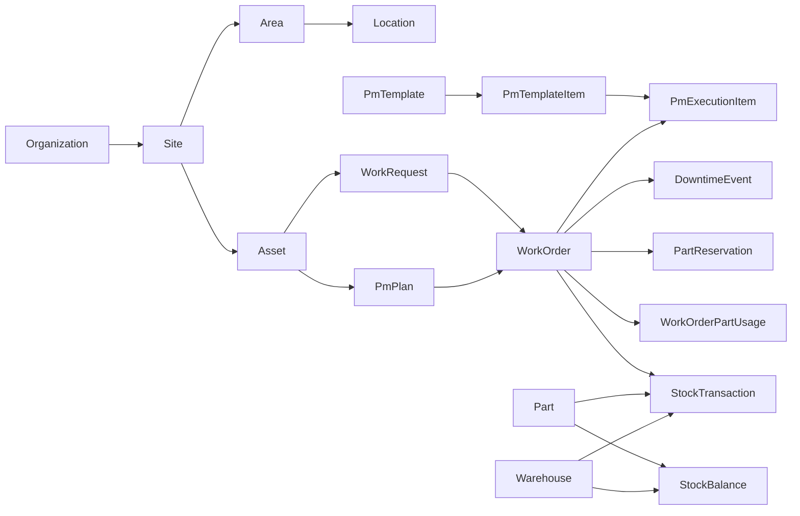

# Data model

`prisma/schema.prisma` and 13 versioned migrations define the implementation. IDs are CUID; business codes are separate transactional counters. QR uses a stable random UUID. Timestamps are UTC timestamptz, PM schedule fields are PostgreSQL dates representing Bangkok calendar dates. Historical foreign keys use Restrict. Operational records archive/disable rather than hard-delete.

| Domain | Models and integrity |
|---|---|
| Identity | User, six Role values, LoginAttempt; live activity/role check each protected operation, sanitized user projection |
| Hierarchy | Organization/Site/Area/Location; scoped business-code unique constraints, services enforce active matching parents and reject reparenting |
| Masters | MasterData unique(kind,code), validated kinds for categories/failure/UOM/team; kind immutable, UOM decimal policy frozen after ledger exists |
| Assets | Asset category/site/area/location, creator/updater, archive, globally unique code and QR token |
| Requests | WorkRequest reporter/reviewer/timestamps/reason/internal note; source request unique in WorkOrder, reciprocal conversion links written atomically |
| Maintenance | WorkOrder exact status enum; WorkOrderActivity append events; Comment; one optional primary DowntimeEvent per corrective WO; valid time/positive duration checks |
| PM | PmTemplate/items archive old revisions; PmPlan fixed next due, frequency/lead/default assignee; unique(pmPlanId,scheduledDueDate); PmExecutionItem snapshots title/instruction/type/limits/required/fail rules/safety, responses and completion actor |
| Files | Attachment exactly one parent asset/request/WO/part, optional PM execution item, positive size, random storage key; private files streamed after parent authorization |
| Inventory | Part and Warehouse; StockBalance unique(partId,warehouseId), onHand/reserved Decimal(18,4), bin; PartReservation bounded issued quantity/status; WorkOrderPartUsage unique WO/part/warehouse, cumulative issued/returned and optional reference cost snapshot |
| Ledger | StockTransaction positive Decimal quantity, unique code, actor/time/optional WO/reason; issue/return requires WO; adjustment requires reason; INITIAL unique per part/warehouse |
| Traceability | AuditLog sanitized before/after/actor; Notification owner/type/link/readAt; BusinessCounter separate for readable codes |

## Transaction and database enforcement

Serializable transactions retry P2034 up to four times. Conversion, PM generation, stock posting, reservation, issue/return and terminal reservation release are atomic. Quantity uses Prisma Decimal, never a JavaScript floating-point balance mutation.

PostgreSQL ledger INSERT trigger applies the signed change to onHand. Balance guard rejects nonzero initial balances and direct onHand changes. Ledger UPDATE/DELETE trigger rejects changes even through Prisma. Constraints enforce onHand >= 0, reserved >= 0, reserved <= onHand, reservation quantity > 0/issued <= quantity and returned <= issued. Consumed reserved quantity is released before the issue ledger insert so the check holds after every statement. Reserved quantity is reconciled with active/partial reservations; it is not an on-hand movement.

Issue uses free stock plus this WO's remaining reservation, preserving other WOs' reservations. Returns reference the same WO/part/warehouse and cannot exceed its outstanding quantity. Returns after terminal WO are allowed as audited reversal transactions; they do not alter maintenance execution. Closed execution cannot be edited. A supervisor may end an existing open downtime after terminal WO only with a reason, preserving its start and recording audit.

Indexes cover filters/joins: asset site/area/category/status/code, WO assignee/status/due/asset/date/type, request reporter/status/date, PM next due/occurrence, item sequence, stock part/warehouse/time/type, usage part/time, reservations part/warehouse/status, notification owner/read/time, audit entity/actor/time. Raw SQL is limited to versioned constraints/triggers and bound reporting aggregates.

Fresh migration/seed/integration and zero balance mismatches are recorded in `FRESH_DATABASE_VERIFICATION.json`.
